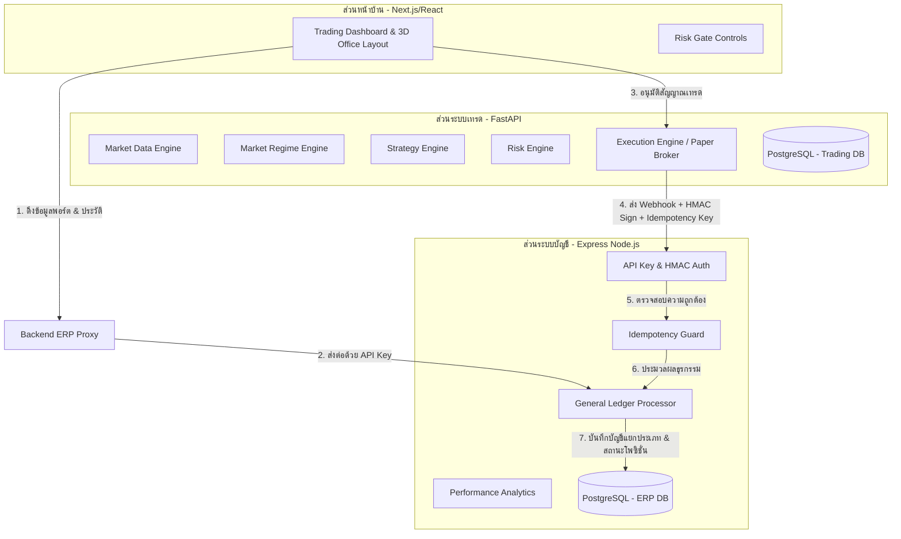

# รายงานการวิเคราะห์และสรุปภาพรวมระบบเทรดและ ERP (System Analysis & Walkthrough)

รายงานนี้แสดงรายละเอียดของระบบเทรดอัจฉริยะ (AI Trading Command Center) บูรณาการร่วมกับระบบบัญชีและภาษีของทีมเทรด (ERP & Tax Compliance Service) โดยจะวิเคราะห์การทำงานของระบบในปัจจุบัน ขั้นตอนการทำงาน และเปรียบเทียบความแตกต่างอย่างละเอียดกับระบบในเวอร์ชันแรกสุดที่ดาวน์โหลดมา (Original Cloned Version)

---

## 1. โครงสร้างและการทำงานของระบบในปัจจุบัน (Current System Architecture)

ระบบประกอบด้วย 3 ส่วนหลักที่ทำงานประสานกันอย่างใกล้ชิด:

### 1.1 Frontend (หน้าบ้าน - พอร์ต 3000)
- หน้าจอ UI ในสไตล์ **Dark Mode Glassmorphism** ที่แสดงห้องทำงาน 3D Isometric ทั้งหมด 9 ห้อง (AI Agents แต่ละฝ่าย)
- จัดแนวกล่องข้อความสนทนา (Speech Bubbles) ไว้ด้านข้างของห้องเพื่อไม่ให้บังส่วนแกนกลางของภาพ
- **Risk Gate Control Panel**: อนุญาตให้ปรับแต่งค่าควบคุมความเสี่ยง เช่น Lot, SL (Stop Loss), TP (Take Profit), Spread Limit, Reject Threshold, และ Risk % ก่อนอนุมัติเทรด
- **Approve Button Rules**: ปุ่ม "อนุมัติ" (Approve) จะถูกเปิดใช้งานเฉพาะตอนที่บอทมีสัญญาณเข้าซื้อขายจริง (`BUY` หรือ `SELL`) เท่านั้น หากอยู่ในสถานะ `WAIT` ปุ่มจะถูกปิดการใช้งานเพื่อความปลอดภัย

### 1.2 Backend (ระบบหลักของ AI Agents - พอร์ต 8000)
- พัฒนาด้วย **FastAPI (Python)**
- ประกอบไปด้วย AI Agents ที่ทำหน้าที่วิเคราะห์ตลาด ได้แก่:
  - **Market Data Engine**: ดึงข้อมูลราคาแบบ Real-time
  - **Market Regime Engine**: ประเมินสภาวะตลาด (เช่น BULL, BEAR)
  - **News Intelligence Engine**: อ่านและวิเคราะห์ข่าวด้วย AI
  - **Strategy Engine**: วิเคราะห์หาจุดเข้าซื้อขาย (BUY/SELL)
  - **Risk Engine**: คำนวณความเสี่ยงและปรับขนาด Lot ตามข้อมูล Risk Gate จากหน้าบ้าน
  - **Execution Engine (Paper Broker)**: จัดการส่งคำสั่งและเฝ้าติดตามคำสั่งซื้อขายที่ทำงานอยู่ (Active Trades)
- มีระบบ **Proxy API** เชื่อมโยงไปยังเซิร์ฟเวอร์ ERP เพื่อดึงรายงานบัญชีแยกประเภทและภาษีโดยแนบ API Key ที่ถูกต้องป้องกันการเข้าถึงที่ไม่ได้รับอนุญาต

### 1.3 ERP Service (ระบบบัญชีและการเงิน - พอร์ต 5001)
- พัฒนาด้วย **Node.js (Express)**
- ทำหน้าที่เป็นระบบบัญชีกลางและระบบคำนวณภาษีของกองทุนเทรด โดยรับข้อมูลผ่าน Webhook จาก Backend
- บันทึกสมุดบัญชีแยกประเภททั่วไป (General Ledger) ด้วยรูปแบบเดบิต (Debit) / เครดิต (Credit) ตามหลักการบัญชีคู่ (Double-Entry Bookkeeping)
- วิเคราะห์ผลการดำเนินงานการเทรดเชิงลึก (เช่น อัตราการชนะ Win Rate, Profit Factor, Expectancy, Max Drawdown)
- วิเคราะห์ภาษีสะสมแยกเป็นประมาณการภาษีเงินได้นิติบุคคล (Corporate Tax) และภาษีมูลค่าเพิ่มที่ขอคืนได้ (Claimable Input VAT)

---

## 2. ขั้นตอนการส่งคำสั่งเทรดและการบันทึก ERP (Step-by-Step Trade Lifecycle)

เมื่อระบบทำการเทรดเสร็จสิ้น ขั้นตอนการทำงานจริงจะเป็นดังนี้:

1. **การกำเนิดสัญญาณ (Signal Generation)**:
   - บอทวิเคราะห์ตลาดพบสัญญาณ (เช่น `BUY BTCUSDT`) ส่งค่ามาที่หน้าบ้านและแสดงปุ่มอนุมัติ
2. **การอนุมัติ (Trade Execution)**:
   - เมื่อผู้ใช้กดอนุมัติ (หรือบอทอนุมัติเองในโหมด Auto Scan) ระบบจะส่งพารามิเตอร์ที่หน้าบ้านตั้งไว้ (Lot, SL, TP, Spread) ไปยัง Backend
   - Risk Engine ตรวจสอบความถูกต้องและส่งค่าคำสั่งซื้อขายจริงไปยัง Paper Broker
3. **การเปิดโพซิชั่น (Trade Opened Event)**:
   - เมื่อออเดอร์เปิดสำเร็จใน Broker, Execution Engine จะส่งข้อมูล Webhook ไปยัง ERP ด้วย Event `trade.opened`
   - ใน Webhook จะมี Header `X-Signature` (HMAC SHA-256) และ `Idempotency-Key` (UUID4) เสมอ
   - ERP ตรวจสอบความถูกต้องของลายเซ็น และตรวจสอบว่า `Idempotency-Key` เคยประมวลผลไปแล้วหรือยัง (ถ้าซ้ำจะข้ามการบันทึกทันที)
   - บันทึกการเดบิตเข้าบัญชี **10200 - พอร์ตลงทุน (ระหว่างเทรด)** และเครดิตจากบัญชี **10100 - เงินสดในบัญชีเทรด**
   - เพิ่มประวัติในตารางสถานะพอร์ตเทรด (`trade_positions`) เป็นสถานะ `OPEN`
4. **การบริหารจัดการออเดอร์ระหว่างเทรด (Advanced Events)**:
   - หากราคาขยับไปจนระบบทำการขยับ Stop Loss ไปจุดคุ้มทุน จะยิง Webhook `trade.break_even` (สถานะเปลี่ยนเป็น `BREAK_EVEN`)
   - หากระบบเปิดใช้งาน Trailing Stop จะยิง Webhook `trade.trailing_activated` เพื่ออัปเดตระดับ SL ล่าสุดลงใน ERP
   - หากมีการทยอยปิดสัญญาบางส่วน จะยิง Webhook `trade.partial_closed` เพื่อรับรู้กำไร/ขาดทุนบางส่วน
5. **การปิดโพซิชั่นและคิดค่าสถิติ (Trade Closed & PnL Event)**:
   - เมื่อปิดออเดอร์ (ชน SL/TP หรือปิดมือ) จะยิง Webhook `trade.closed` / `trade.pnl_realized`
   - ERP บันทึกรับรู้กำไรเข้าบัญชี **40100 - รายได้จากการลงทุน** หรือเดบิตขาดทุนเข้าบัญชี **50100 - ขาดทุนจากการลงทุน**
   - บันทึกค่าธรรมเนียมโบรกเกอร์ (Broker Fee) เข้าบัญชี **50200 - ค่าธรรมเนียมโบรกเกอร์**
   - บันทึกภาษีซื้อที่เกิดจากค่าธรรมเนียมเข้าบัญชี **18100 - ภาษีซื้อ (ขอคืนได้)**
   - อัปเดตตาราง `trade_positions` เป็นสถานะ `CLOSED` พร้อมทั้งบันทึกราคาปิด, กำไรสุทธิ, ค่าธรรมเนียม, อัตราผลตอบแทนต่อความเสี่ยง (R:R Ratio) และเวลาที่ใช้ออเดอร์เปิดค้างไว้ (Duration)

---

## 3. ตารางเปรียบเทียบระบบเวอร์ชันดั้งเดิม (Original) กับเวอร์ชันปรับปรุงล่าสุด (Refactored)

| หัวข้อการทำงาน | เวอร์ชันดั้งเดิม (ตอนที่ pull มาครั้งแรก) | เวอร์ชันอัปเกรดล่าสุด (ในปัจจุบัน) |
| :--- | :--- | :--- |
| **การเก็บข้อมูล (Storage)** | เก็บข้อมูลในตัวแปร Array บน Memory (เมื่อเซิร์ฟเวอร์ Restart ข้อมูลทั้งหมดจะหาย) | ใช้ฐานข้อมูล **PostgreSQL** จริงแยกตารางระบบบัญชี/สถิติ มีดัชนี (Indexes) 9 ตัวเพื่อความเร็ว |
| **ระบบความปลอดภัย (Security)** | ไม่มีระบบล็อกอินหรือตรวจสอบสิทธิ์ (เข้าถึงได้หมดแบบ Public) | ระบบป้องกันด้วย **API Key Authentication (`X-Api-Key`)** และปิดกั้นหน้าแอดมินล้างข้อมูลนอก dev mode |
| **การยืนยันผู้ส่ง (Webhook Integrity)** | รับข้อมูลดิบทาง Webhook ตรงๆ โดยไม่มีการพิสูจน์ตัวตนผู้ส่ง | เข้ารหัสและตรวจสอบข้อมูลด้วยลายเซ็น **HMAC SHA-256 Signature (`X-Signature`)** ป้องกันบอทปลอม |
| **การดักจับข้อมูลซ้ำ (Idempotency)** | ไม่มีระบบดักจับข้อมูลซ้ำ ส่งคำสั่งเบิ้ลส่งผลให้ข้อมูลบัญชีเพี้ยนทันที | ป้องกันข้อมูลซ้ำซ้อนโดยใช้ **Idempotency Key** และจัดเก็บประวัติลงใน `erp_delivery_records` |
| **ประเภทธุรกรรม (Events)** | รองรับแค่ 3 รูปแบบเหตุการณ์พื้นฐาน (`trade.opened`, `trade.pnl_realized`, `fee.recorded`) | รองรับเหตุการณ์แบบโปรดักชันรวม 6 รูปแบบ (`opened`, `closed`, `partial_closed`, `break_even`, `trailing_activated`, `fee`) |
| **การบันทึกสถานะพอร์ต (Trade Tracking)** | ไม่มีระบบติดตามสถานะการเปิดออเดอร์ใน ERP มีแค่บันทึก Ledger | มีระบบติดตามตาราง **`trade_positions`** บันทึกประวัติราคาทั้งหมด R:R Ratio และเวลาในการถือครองออเดอร์ |
| **การวิเคราะห์การเทรด (Analytics)** | ไม่มีระบบคำนวณสถิติจริง | มีชุด API วิเคราะห์สถิติจริง: **Win Rate, Profit Factor, Average R:R, Expectancy, Max Drawdown** |
| **ความพร้อมของระบบ (Observability)** | ไม่มีตัวช่วยมอนิเตอร์การทำงาน | มีหน้าตรวจสอบสิทธิ์ **`/health/deep`** เช็กความสมบูรณ์ DB และ **`/metrics`** สำหรับ Prometheus |
| **การปิดโปรแกรม (Reliability)** | เมื่อสั่งปิด Node.js จะตัดทันที เสี่ยงต่อการเขียนฐานข้อมูลค้างและข้อมูลพัง | มีระบบ **Graceful Shutdown** เมื่อได้รับ `SIGTERM`/`SIGINT` จะรอเคลียร์ Pool ฐานข้อมูลก่อนปิดตัว |

---

## 4. โครงสร้างตารางในฐานข้อมูล ERP (Database Schema Details)

ระบบ ERP ได้รับการขยายตารางออกเป็น 5 ตารางหลักเพื่อรองรับการบันทึกบัญชีที่แม่นยำและตรวจสอบได้ (Auditable):

### 4.1 ตารางสมุดบัญชีหลัก (`erp_ledger`)
ใช้บันทึกรายการบัญชีเดบิตและเครดิตแยกประเภท:
- `id` (VARCHAR PRIMARY KEY) - รหัสธุรกรรม
- `timestamp` (TIMESTAMPTZ) - เวลาบันทึกบัญชี
- `event` (VARCHAR) - ประเภทของเหตุการณ์
- `description` (TEXT) - คำอธิบายรายละเอียดรายการบัญชี
- `pnl` (DOUBLE PRECISION) - ยอดกำไร/ขาดทุน
- `debit_account` / `debit_amount` - ชื่อบัญชีและจำนวนเงินฝั่งเดบิต
- `credit_account` / `credit_amount` - ชื่อบัญชีและจำนวนเงินฝั่งเครดิต
- `trade_id` (VARCHAR) - รหัสอ้างอิงออเดอร์จริงในระบบเทรด (ใช้เชื่อมโยงประวัติ)
- `correlation_id` (VARCHAR) - รหัสติดตามความสัมพันธ์ของการเรียกใช้ระบบ API

### 4.2 ตารางประวัติออเดอร์ (`trade_positions`)
ใช้ประเมินสถิติและผลการดำเนินงานของทีมเทรด:
- `trade_id` (VARCHAR UNIQUE) - รหัสอ้างอิงออเดอร์
- `symbol` (VARCHAR) - สินทรัพย์ที่เทรด (เช่น BTCUSDT)
- `action` (VARCHAR) - ประเภทการสั่งซื้อ (BUY/SELL)
- `entry_price` / `exit_price` - ราคาเปิดและราคาปิดออเดอร์
- `lot_size` (DOUBLE PRECISION) - ขนาดการเทรด (Lot)
- `stop_loss` / `take_profit` - จุดตัดขาดทุนและเป้าหมายทำกำไร
- `realized_pnl` (DOUBLE PRECISION) - กำไร/ขาดทุนสะสมที่เกิดขึ้นจริง
- `fee` (DOUBLE PRECISION) - ค่าธรรมเนียมโบรกเกอร์ของออเดอร์นี้
- `rr_ratio` (DOUBLE PRECISION) - อัตราผลตอบแทนจริงเทียบความเสี่ยงที่เกิดขึ้น (Risk-Reward Ratio)
- `duration_minutes` (INTEGER) - ระยะเวลาที่ถือครองออเดอร์ตั้งแต่เปิดจนปิด
- `status` (VARCHAR) - สถานะปัจจุบัน (`OPEN`, `CLOSED`, `BREAK_EVEN`, `TRAILING`)

### 4.3 ตารางป้องกันข้อมูลซ้ำซ้อน (`erp_delivery_records`)
ใช้ตรวจสอบความถูกต้องในการส่งข้อมูล Webhook:
- `idempotency_key` (VARCHAR UNIQUE) - คีย์ตรวจสอบความซ้ำซ้อน
- `event` (VARCHAR) - ชื่อเหตุการณ์
- `status` (VARCHAR) - สถานะการทำงาน (`PENDING`, `SUCCESS`, `ERROR`, `FAILED`)
- `response_code` (INTEGER) - รหัสตอบกลับ HTTP Status Code
- `payload` (JSONB) - ข้อมูลดิบที่รับมาจากบอทเพื่อใช้ตรวจสอบย้อนหลัง

### 4.4 ตารางบันทึกการทำงานของระบบความปลอดภัย (`audit_logs`)
บันทึกประวัติความปลอดภัยและการเชื่อมต่อทั้งหมด:
- `event_type` (VARCHAR) - ชนิดของการตรวจจับ (เช่น `AUTH_FAILED`, `WEBHOOK_RECEIVED`, `WEBHOOK_PROCESSED`)
- `user_agent` (TEXT) - ข้อมูลเบราว์เซอร์หรือเครื่องของบอทที่ยิงคำสั่ง
- `ip_address` (VARCHAR) - หมายเลข IP ที่ส่งมา
- `correlation_id` (VARCHAR) - คีย์ตรวจสอบ
- `payload` (JSONB) - รายละเอียดเพิ่มเติมของข้อผิดพลาดหรือเหตุการณ์

### 4.5 ตารางข้อมูลการเงินสะสม (`erp_stats`)
ตารางข้อมูลสรุปย่อแบบแถวเดียว (Singleton) เพื่อประหยัดเวลาการประมวลผลบนหน้าบ้าน:
- `accumulated_fees` (DOUBLE PRECISION) - ยอดค่าธรรมเนียมโบรกเกอร์สะสมรวมทั้งหมด
- `accumulated_pnl` (DOUBLE PRECISION) - ยอดกำไร/ขาดทุนสะสมรวมทั้งหมด

---

## 5. สรุปความแตกต่างทางด้านข้อมูล (Data Consistency & Integrity)

1. **ไม่มีการลอยตัวของข้อมูล (Persistent Storage)**:
   ในเวอร์ชันแรก เมื่อทีมเทรดทดลองกดสั่งเปิดออเดอร์จำนวนมากแล้วเซิร์ฟเวอร์ ERP เกิดรีสตาร์ต ข้อมูลสะสมจะถูกตีกลับไปเป็น 0 หรือค่าเริ่มต้นเริ่มต้นทันที (กำไรสะสม 2,340.50 ดอลลาร์ และค่าธรรมเนียมสะสม 145.20 ดอลลาร์ แบบ Hardcoded) แต่ในเวอร์ชันปัจจุบัน **ข้อมูลทุกอย่างบันทึกลงฐานข้อมูล PostgreSQL** และจะดึงผลสรุปล่าสุดจากบันทึกธุรกรรมจริงตลอดเวลา
2. **การป้องกันปัญหาธุรกรรมหล่นหายหรือเบิ้ลซ้ำ**:
   ด้วยการใช้ `Idempotency-Key` ตรวจจับความถูกต้อง ทำให้ไม่ว่าจะเกิดข้อผิดพลาดทางด้านเน็ตเวิร์กที่ทำให้บอทพยายามยิง Webhook เดิมซ้ำ (Retry Mechanism) บัญชีคลัง ERP จะไม่มีการบันทึกรายการเพิ่มเข้าไปซ้ำเด็ดขาด ซึ่งดีกว่าแบบเดิมที่ไม่มียืนยันตัวตนหรือความซ้ำซ้อนและจะทำการบันทึกยอดเงินทับถมไปเรื่อยๆ จนส่งผลให้บัญชีแยกประเภทคลาดเคลื่อน
3. **การเข้าถึงแบบปลอดภัยสูงสุด**:
   ทุกการสืบค้นข้อมูลบัญชีจากหน้าบ้านจะต้องผ่านการตรวจสอบ API Key เสมอ และ webhook จะไม่สามารถถูกยิงจากเครื่องบุคคลอื่นภายนอกที่ไม่ทราบความลับ `ERP_WEBHOOK_SECRET` ของทีมเทรดได้เลย
