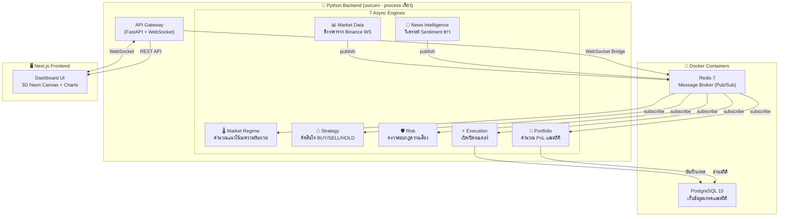

# 🧠 AI Trading System — วิธีการทำงานและข้อแตกต่างหลังอัปเกรด

## สถาปัตยกรรมปัจจุบัน: Asynchronous Monolith

ระบบถูกออกแบบเป็น **Asynchronous Monolith** — คือรัน Python process เดียว (`uvicorn`) แต่ภายในมี 7 Engines ทำงานพร้อมกันแบบ async ผ่าน `asyncio.create_task` โดยสื่อสารกันผ่าน **Redis Pub/Sub**



---

## 🔄 Data Flow — ข้อมูลไหลอย่างไร

ข้อมูลไหลจากซ้ายไปขวาตามลำดับ **Pipeline** ผ่าน Redis channels:

### ขั้นตอนที่ 1: รับข้อมูลตลาด
> **Market Data Engine** → เชื่อมต่อ Binance WebSocket ดึงราคา BTC, ETH, SOL แบบ realtime → publish ไปที่ channel `market:tick`

### ขั้นตอนที่ 2: วิเคราะห์บริบทตลาด
> **News Intelligence** → วิเคราะห์ sentiment ข่าวด้วย VADER → publish `news:sentiment`
> **Market Regime** → subscribe `market:tick` → คำนวณ Volatility + Trend → สรุปว่าตลาดเป็น `BULL_HIGH_VOL`, `SIDEWAYS_LOW_VOL` ฯลฯ → publish `market:regime:current`

### ขั้นตอนที่ 3: ตัดสินใจ
> **Strategy Engine** → subscribe ทั้ง `market:regime:current` + `news:sentiment` → ใช้กฎ AI ตัดสินใจ → ถ้าเหมาะสม จะ publish สัญญาณ BUY/SELL ไปที่ `ai:signal:generated`

### ขั้นตอนที่ 4: ตรวจสอบความเสี่ยง
> **Risk Engine** → subscribe `ai:signal:generated` → เช็คว่าเปิดไม้ได้มั้ย (position limit, max drawdown, win rate ขั้นต่ำ) → ถ้าผ่าน publish `risk:signal:approved` / ถ้าไม่ผ่าน `risk:signal:rejected`

### ขั้นตอนที่ 5: ดำเนินการเทรด
> **Execution Engine** → subscribe `risk:signal:approved` → จำลองการเปิดออเดอร์ (รวม slippage 0.01%) → บันทึกลง PostgreSQL → publish `execution:trade:opened`

### ขั้นตอนที่ 6: คำนวณผลงาน
> **Portfolio Engine** → subscribe `execution:trade:opened/closed` → คำนวณ PnL, Win Rate, Sharpe Ratio → publish `portfolio:metrics:updated`

### ขั้นตอนที่ 7: แสดงผล UI
> **WebSocket Bridge** ใน `main.py` → subscribe ทุก channel → broadcast ไปที่ Next.js frontend ผ่าน WebSocket → UI อัปเดตแบบ realtime

---

## ⚡ ข้อแตกต่างหลัก: ก่อน vs หลังอัปเกรด

| หัวข้อ | 🔴 ระบบเก่า (`ai-tradee`) | 🟢 ระบบใหม่ (`ai-trading`) |
|--------|---------------------------|---------------------------|
| **สถาปัตยกรรม** | Microservices — รัน 8 Python processes แยกกัน | **Asynchronous Monolith** — process เดียว, 7 async tasks |
| **วิธีเปิดระบบ** | ต้องเปิด terminal 8 หน้าต่าง แต่ละตัวรันแยก port | `python -m uvicorn backend.main:app --reload` **คำสั่งเดียว** |
| **การสื่อสาร** | Redis Pub/Sub ระหว่าง processes | Redis Pub/Sub เหมือนเดิม แต่อยู่ใน process เดียว (เร็วขึ้น) |
| **ฐานข้อมูล** | PostgreSQL + SQLAlchemy | เหมือนเดิม แต่รันผ่าน Docker Compose (สะดวกกว่า) |
| **Frontend** | ไม่มี UI หรือมีแบบง่ายๆ | **Next.js Dashboard** พร้อม 3D Neon Canvas, realtime charts |
| **WebSocket** | ไม่มี bridge ไป UI | มี **WebSocket Bridge** — pipe ข้อมูลจาก Redis ไป UI ตรงๆ |
| **การ Deploy** | ยุ่งยาก ต้อง config ทีละ service | `docker-compose up -d` + `uvicorn` = จบ |
| **Memory** | กิน RAM 8 เท่า (8 Python processes) | ประหยัด RAM — process เดียว share memory |
| **Error Handling** | ถ้า 1 service ตาย ต้องไปรีสตาร์ทเอง | ถ้า engine ตาย, process หลักยังอยู่ สามารถ recover ได้ |

---

## 📁 โครงสร้างไฟล์หลัก

```
ai-trading/
├── docker-compose.yml          ← 🐳 PostgreSQL + Redis
├── backend/
│   ├── main.py                 ← 🚀 API Gateway + เปิดทุก Engine
│   ├── requirements.txt        ← 📦 Dependencies ทั้งหมด
│   ├── engines/                ← ⚙️ 7 Trading Engines
│   │   ├── market_data.py      ← ดึงราคาจาก Binance
│   │   ├── news_intelligence.py← วิเคราะห์ข่าว
│   │   ├── market_regime.py    ← วิเคราะห์แนวโน้มตลาด
│   │   ├── strategy.py         ← ตัดสินใจเทรด
│   │   ├── risk.py             ← ตรวจสอบความเสี่ยง
│   │   ├── execution.py        ← เปิด/ปิดออเดอร์
│   │   └── portfolio.py        ← คำนวณผลงาน
│   └── shared/                 ← 🔗 โมดูลที่ใช้ร่วมกัน
│       ├── database/
│       │   ├── core.py         ← SQLAlchemy connection
│       │   └── models.py       ← ตาราง Trade, Position ฯลฯ
│       ├── events/
│       │   └── core.py         ← EventBus (Redis Pub/Sub)
│       └── schema/
│           └── events.py       ← Pydantic schemas
└── frontend/
    └── src/app/page.tsx        ← 🖥️ Next.js Dashboard UI
```

---

## 🚀 คำสั่งเปิดระบบ

```powershell
# 1. เปิด Infrastructure (Docker)
cd c:\Users\akkar\ai-trading
docker-compose up -d

# 2. เปิด Backend (Python 3.14)
python -m uvicorn backend.main:app --host 0.0.0.0 --port 8000 --reload

# 3. เปิด Frontend (อีก terminal)
cd frontend
npm run dev
```

> [!TIP]
> **สรุปสั้นๆ**: ระบบเก่าต้องเปิด 8 terminal windows ทีละตัว — ระบบใหม่เปิดแค่ **3 คำสั่ง** (docker + backend + frontend) แล้วทุกอย่างทำงานร่วมกันเป็น pipeline อัตโนมัติผ่าน Redis!
