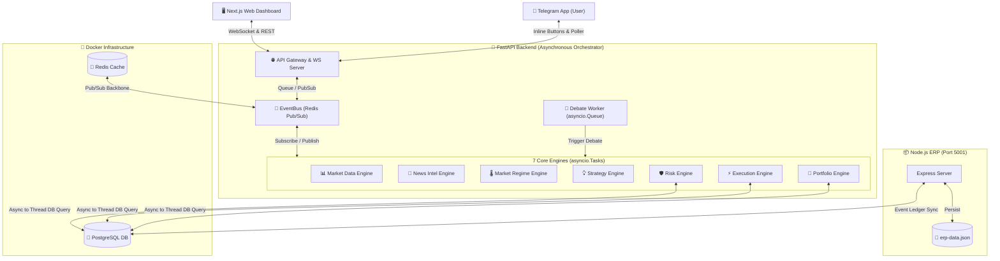

# 🏛️ รายงานการวิเคราะห์ระบบ AI Trading Command Center (ฉบับสมบูรณ์)

รายงานฉบับนี้วิเคราะห์สถาปัตยกรรมเชิงลึก การไหลของข้อมูล (Data Flow) และขีดความสามารถของระบบ **AI Trading Command Center** ในเวอร์ชันปัจจุบัน (Production-Ready)

---

## 🧭 1. ภาพรวมสถาปัตยกรรมระบบ (Architecture Overview)

ระบบถูกอัปเกรดเป็นสถาปัตยกรรม **Asynchronous Monolith** ที่มีประสิทธิภาพสูง ทำงานร่วมกันในรูปแบบ Event-Driven Pipeline ผ่าน **Redis Pub/Sub** แทนการรันแยก Process แบบเดิม ช่วยลดปริมาณหน่วยความจำ (RAM) และการหน่วงของเวลา (Latency)



---

## ⚡ 2. ขีดความสามารถหลักในปัจจุบัน (Key Capabilities Breakdown)

### 📊 2.1. Market Data & regime Analyzer
* **Real-time Price Stream:** ดึงข้อมูลราคาเหรียญ BTCUSDT, ETHUSDT, SOLUSDT และหุ้นเทคโนโลยี (NVDA, TSLA, MSFT ฯลฯ) จาก Binance และผู้ให้บริการข้อมูลการเงินอื่นๆ
* **Technical Indicators Processing:** คำนวณตัวชี้วัดจริง ได้แก่:
  * **RSI (Relative Strength Index)** ตรวจหาภาวะ Overbought / Oversold
  * **MACD (Moving Average Convergence Divergence)** หาโมเมนตัมแนวโน้มราคา
  * **Bollinger Bands & ATR (Average True Range)** ประเมินความผันผวนและตั้งจุดหยุดขาดทุน (Stop Loss)

### 📰 2.2. News Intelligence (VADER Sentiment Analysis)
* **Real-world NewsAPI Integration:** เชื่อมโยงกับ API ข่าวจริงเพื่อดึงข้อมูลข่าวสารรายชั่วโมงของแต่ละคู่สินทรัพย์
* **Weighted Multi-Article Sentiment:** วิเคราะห์ความรู้สึกของข่าวโดยใช้โมเดล **VADER Sentiment Analyzer** คำนวณคะแนนแบบถ่วงน้ำหนักความสำคัญและสรุปคะแนนออกมาเป็นทิศทางของอารมณ์ตลาด (Bullish / Bearish / Neutral) เพื่อส่งต่อให้ Strategy Engine

### 🧠 2.3. AI Virtual Office & Interactive Debate Engine
ระบบมี AI Agents ประจำหน้าที่อยู่ 6 ฝ่าย ที่ทำสภาวิพากษ์สัญญาณเทรดแบบไร้การขัดข้องทางข้อมูล (No Race Conditions) ผ่าน `asyncio.Queue`:
1. **CEO Agent (Orchestrator):** เปิดประชุม สรุปทิศทาง และเสนอการตัดสินใจขั้นสุดท้าย
2. **Chart AI (Technical Analyst):** ประเมินสัญญาณกราฟ ตัวชี้วัด แนวรับและแนวต้านสำคัญ
3. **Crypto Desk AI (Crypto Specialist):** ประเมินพฤติกรรมเฉพาะตัวของ Order Flow คริปโต
4. **Wallet Intel AI (Accountant):** ตรวจสอบยอดเงินคงเหลือ ความปลอดภัยของพอร์ตเทรด
5. **Risk AI (The Guardian):** กรองและสรุปกฎเหล็กบริหารความเสี่ยงระดับสุดยอด
6. **News & Macro AI (Fundamental Analyst):** สรุปอิมแพ็คจากประเด็นเศรษฐกิจมหภาค

> [!NOTE]
> **ระบบฉลาดสองทาง (Claude vs Template Fallback)**
> * หากผู้ใช้กรอก **Anthropic API Key** จริง ระบบจะยิงข้อมูลไปให้ **Claude 3.5 / 4.5** สตรีมคำพูดแสดงความคิดเห็นแบบแยกบทบาทวิเคราะห์จริงผ่าน WebSocket
> * หากไม่มี API Key หรือ API ขัดข้อง ระบบจะสลับไปใช้งาน **Dynamic Smart Templates** ที่นำข้อมูลสถิติสดจากบอร์ดมาแปลงเป็นรายงานทันที เพื่อป้องกันระบบหยุดทำงาน

### 📱 2.4. Interactive Telegram Command Center
* **Live Debate Broadcast:** ส่งเนื้อหาที่ AI สภากำลังประชุมร่วมกันทีละขั้นตอน (Streaming Step) ไปยังมือถือของผู้ใช้ผ่าน Telegram Group/Chat แบบเรียลไทม์
* **Interactive Inline Buttons:** เมื่อสภามีมติอนุมัติเทรด จะมีปุ่ม **"✅ อนุมัติเทรด (Approve)"** และ **"❌ ปฏิเสธ (Reject)"** ใต้ข้อความ Telegram ให้ผู้ใช้อนุมัติจากนอกบ้าน หากคลิกอนุมัติ สัญญาณจะส่งกลับผ่าน Telegram Webhook/Poller เข้ามาสั่งยิงออเดอร์ในระบบจริงทันที

### 🛡️ 2.5. Risk Guardrails & Active Exposure check
* **PostgreSQL Sync:** ตัวตรวจสอบความเสี่ยงจะคอยดึงรายการ `open_positions` จริงจากฐานข้อมูล PostgreSQL ในการคำนวณ
* **Dynamic Lot Sizing (ATR-based):** ปรับเปลี่ยนขนาด Lot ไซส์ของทุกๆ ไม้แปรผันตามค่าความผันผวนล่าสุดของสินทรัพย์นั้นๆ
* **Dual-Limit Exposure Check:** ป้องกันการล้างพอร์ตโดยจำกัดความเสี่ยงแยกรายเหรียญ (Per-ticker limit) และจำกัดสัดส่วนความเสี่ยงรวมทั้งพอร์ต (Total Portfolio Exposure Check)

### 📦 2.6. ERP Ledger Integration (บัญชีแยกประเภทภาษีและงบดุล)
* **Persistent Storage:** ERP แยกไปรันที่ Port `5001` โดยใช้ Express.js และเก็บข้อมูลลงไฟล์ JSON แบบทนทาน (`erp-data.json`)
* **Tax VAT Ledger entries:** มีการบันทึกรายการรายรับ-รายจ่ายที่อ้างอิงธุรกรรมจริง บันทึกมูลค่าภาษีมูลค่าเพิ่ม (VAT 7%) อัตโนมัติ
* **Robust Error Prevention:** มีกลไกป้องกันพอร์ตเซิร์ฟเวอร์ชนกัน (`EADDRINUSE`) หากมี Process เก่าค้างอยู่ ระบบจะจัดการหลีกเลี่ยงหรือปิดตัวเองลงอย่างสุภาพ

---

## 🔄 3. การเชื่อมโยงข้อมูลภายใน (Internal Data Flow)

ลำดับการทำงานเมื่อได้รับข้อมูลราคาสินทรัพย์ใหม่:

```text
[ Binance WebSocket / API Data ]
               │
               ▼
[ Market Data Engine ] ──► (Publish to Redis: "market:tick")
               │
               ▼
[ Market Regime Engine ] คำนวณ RSI, Trend, ATR ──► (Publish to Redis: "market:regime")
               │
               ▼
[ Strategy Engine ] รวม Technical + News Sentiment ──► (Publish to Redis: "ai:signal:generated")
               │
               ▼
[ Risk Engine ] ตรวจสอบ Position Size, Exposure ──► (Publish to Redis: "risk:signal:approved")
               │
               ▼
[ Debate Worker Queue ] ──► ยิงข้อความไปหน้าเว็บบอร์ด (WebSockets) + ส่งแจ้งเตือน Telegram
                                            │
                                            ▼
                                   [การตัดสินใจเทรด]
                      ┌─────────────────────┴─────────────────────┐
                      ▼                                           ▼
             [ AUTO MODE ]                                 [ MANUAL MODE ]
                      │                                           │
                      │                                 ส่งข้อความ + ปุ่มกดเข้ามือถือ
                      │                                           │
                      │                              [ User กด Approve จาก Telegram ]
                      │                                           │
                      └─────────────────────┬─────────────────────┘
                                            │
                                            ▼
                               [ Execution Engine ] 
                         เปิด Order / จำลอง Slippage & Latency
                                            │
                                            ▼
                              [ Portfolio / ERP Ledger ]
                             บันทึก DB PostgreSQL & ERP JSON
```

---

## 📈 4. บทวิเคราะห์จุดเด่นเชิงวิศวกรรม (Engineering Strengths)

1. **การควบคุมการรันงานแบบ Asynchronous:** การใช้ `asyncio.to_thread` ทุกครั้งที่มีการอ่านหรือเขียนข้อมูลลง PostgreSQL ป้องกันไม่ให้การทำงานหลัก (Event Loop) หยุดชะงัก (Non-blocking I/O)
2. **ความปลอดภัยของ API Keys:** ระบบมีการปิดบัง (Masking) API Token สำคัญไม่ให้หลุดออกไปทาง log ไฟล์
3. **ระบบ Debate Queue:** ป้องกันปัญหาสัญญาณแย่งกันเข้าสู่ระบบพร้อมกัน (Race Conditions) โดยบอร์ดจะเข้าแถวประมวลผลทีละห้องการเทรดแบบเรียงลำดับ
4. **ความทนทานของข้อมูลทางการเงิน:** ERP ออกแบบมาเพื่อให้ข้อมูลบัญชีที่บันทึกไว้ไม่หายไปไหนเมื่อปิดเซิร์ฟเวอร์ (Persistent JSON Storage)

---

## 🔮 5. คำแนะนำในการขยายระบบในอนาคต (Future Enhancements)
* **การต่อ Live Balance จากกระดานเทรดจริง:** เชื่อมต่อ Binance CCXT/API สำหรับอ่านยอดคงเหลือในบัญชีจริง แทนยอดจำลองในปัจจุบัน
* **Backtesting Engine:** พัฒนาระบบให้สามารถนำประวัติราคาในอดีต (Historical Data) มาจำลองความแม่นยำของโมเดล AI ในอดีตได้ย้อนหลังหลายเดือน
* **การเพิ่มความซับซ้อนของ AI Debate:** พัฒนาให้บอทในสภาส่งข้อมูลโต้เถียงกันเอง 2 รอบก่อน CEO เสนอมติสรุป เพื่อเพิ่มความลึกซึ้งของการวิเคราะห์ปัจจัยพื้นฐาน (Fundamental analysis)
